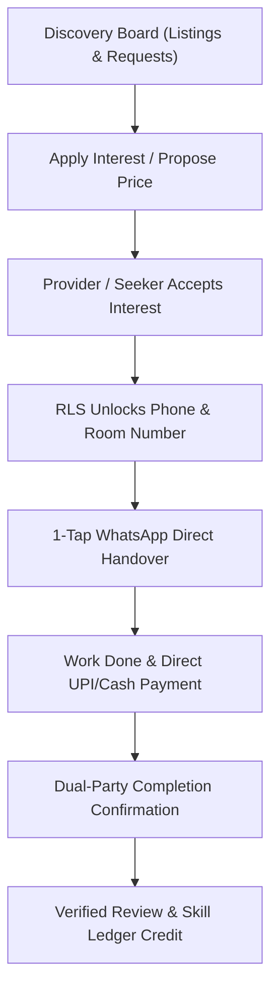

# HostelHire 🎓⚡
> **Peer-to-Peer Campus Micro-Gig & Skill Monetization Platform**  
> *Developed for B.Y.O.T. — Theme: "Innovate for Campus" | Jorhat Engineering College*

---

## 📌 Executive Summary
In residential engineering colleges, everyday micro-problems (broken laptop OS, CAD/ED sheet drafting struggles, midnight bicycle punctures, urgent LaTeX lab record margin fixes) remain trapped in chaotic WhatsApp hostel groups where requests are buried in spam and providers lack trust or pricing clarity.

**HostelHire** turns residential hostels into a high-trust, localized micro-economy. Students monetize specialized skills within their campus boundaries with zero payment gateway fees, progressive contact disclosure (unlocking room/WhatsApp only upon mutual agreement), dual-party completion confirmations, and verified student badges.

---

## 🚀 Key Features

- **Dual-Sided Campus Discovery Board:**
  - *Services Offered:* Discover vetted campus peers who repair electronics, format lab records, tutor coding, or design posters.
  - *Requests Needed:* Post urgent hostel emergencies (e.g., bicycle flat tire, overnight LaTeX deadline) with expected budgets.
- **Privacy-Preserving Contact Disclosure:**
  - Room numbers and phone numbers are masked behind Row-Level Security (RLS) until both parties agree on scope and price.
  - One-tap WhatsApp redirect pre-populates agreed gig details.
- **Dual-Party Completion Confirmation:**
  - Prevents dispute by requiring both seeker and provider to confirm completion before ledger credit and verified reviews unlock.
- **Campus Admin Moderation Console:**
  - Campus authority view to review incident flags, issue warnings/restrictions, and surface high-demand institutional skills.
- **Offline Direct Settlement:**
  - Direct P2P UPI/cash payment between students—eliminating transaction fees and legal escrow friction.

---

## 🛠️ Tech Stack & Architecture

- **Frontend:** Next.js 16 (App Router, Turbopack, React 19)
- **Styling:** Tailwind CSS v4, Lucide Icons, Plus Jakarta Sans typography (Google Stitch design tokens)
- **Database & Auth:** Supabase PostgreSQL with 14 relational entities, custom ENUMs, and Row-Level Security (RLS)
- **Deployment:** Vercel Edge Network



---

## 🗄️ Database Entities

| Entity | Purpose |
| :--- | :--- |
| `profiles` | Roll number, college email, hostel block, room number, verification status |
| `service_listings` | Offered gigs with turnaround times and indicative prices |
| `service_requests` | Urgent student needs with expected budgets and urgency tags |
| `gig_interests` | Formal student applications and negotiated price proposals |
| `gigs` | Active agreements binding seeker, provider, and agreed price |
| `gig_completions` | Dual confirmation records from seeker and provider |
| `reviews` | High-trust ratings linked exclusively to completed gigs |
| `admin_actions` | Incident resolution, warnings, and institutional moderation logs |

---

## ⚡ Getting Started Locally

### 1. Clone & Install
```bash
git clone https://github.com/wasimmos/hostel-life.git
cd hostel-life/web
npm install
```

### 2. Configure Environment Variables
Create a `.env.local` file inside the `web/` directory:
```env
NEXT_PUBLIC_SUPABASE_URL=https://vcxzzuvfdnoovblhvtjc.supabase.co
NEXT_PUBLIC_SUPABASE_ANON_KEY=your-supabase-anon-key
```

### 3. Run Development Server
```bash
npm run dev
```
Open [http://localhost:3000](http://localhost:3000) in your browser.

---

## 👥 Hackathon Team (Team 27)
- **Wasim Ahmed** — Lead Full-Stack & Database Architect
- **Theme:** Innovate for Campus (Residential Hostel Life)
- **Institution:** Jorhat Engineering College (JEC)
